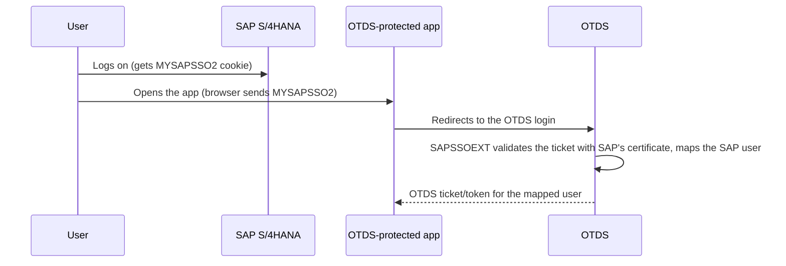
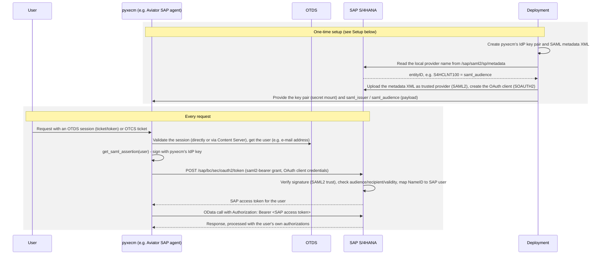

# SAP <-> OTDS Authentication / SSO

This page describes how SAP S/4HANA and OpenText Directory Services (OTDS) can trust
each other, and what `pyxecm` provides for it:

| Direction                                                           | Use case                                                                             | Mechanism                                                                                    | pyxecm                                                |
| ------------------------------------------------------------------- | ------------------------------------------------------------------------------------ | -------------------------------------------------------------------------------------------- | ----------------------------------------------------- |
| [1. OTDS trusts SAP](#direction-1-otds-trusts-sap)                  | A user logged on to SAP opens an OTDS-protected application without logging on again | SAP logon ticket (`MYSAPSSO2`), validated by the OTDS SAPSSOEXT handler                      | `OTDS.add_auth_handler_sap()`                         |
| [2. SAP trusts pyxecm](#direction-2-principal-propagation-into-sap) | pyxecm calls SAP OData APIs **as the individual user** ("principal propagation")     | pyxecm signs a SAML 2.0 assertion, SAP exchanges it for an OAuth 2.0 access token (RFC 7522) | `SAP.get_oauth_access_token_for_user()`, `BearerAuth` |
| [Fallback](#fallback-technical-user)                                | pyxecm calls SAP with one shared technical user                                      | HTTP basic authentication                                                                    | `SAP(username=..., password=...)`                     |

Related docs: [SAP module reference](sap.md), [SAP APIs that must be activated](sap-apis.md).

## Terminology

| Term                            | Meaning                                                                                                                                                                                                                                                   |
| ------------------------------- | --------------------------------------------------------------------------------------------------------------------------------------------------------------------------------------------------------------------------------------------------------- |
| Principal propagation           | A service calls a backend under the identity of the end user (the user's own SAP authorizations and change documents), not as a technical user.                                                                                                           |
| `MYSAPSSO2`                     | SAP's logon ticket (cookie), issued by SAP after a user logged on.                                                                                                                                                                                        |
| SAML 2.0 assertion              | A signed XML document in which an identity provider (IdP) states who a user is.                                                                                                                                                                           |
| SAML 2.0 Bearer Assertion grant | OAuth 2.0 flow (RFC 7522): a client posts a SAML assertion to the token endpoint and gets an access token for the user named in it.                                                                                                                       |
| Transaction `SAML2`             | SAP's SAML 2.0 configuration: the SAP system's own *local provider* and the *trusted (identity) providers*, incl. how their users map to SAP users.                                                                                                       |
| Transaction `SOAUTH2`           | SAP's OAuth 2.0 server configuration: OAuth clients, their grant types, trusted IdPs and scopes.                                                                                                                                                          |
| Local provider                  | SAP's own SAML 2.0 identity in `SAML2` - enabling it (step 2.1) publishes the **local provider name** (e.g. `S4HCLNT100`), the *audience* of pyxecm's assertions. One per SAP client; required even if pyxecm is the only identity provider ever trusted. |
| Trusted provider                | An entry in `SAML2`'s *Trusted Providers* list identifying an external identity provider SAP accepts assertions from - pyxecm registers itself here (step 2.2), using `saml_issuer` as its *entityID*/provider name.                                      |
| OTDS ticket / OTDS access token | OTDS's session token (`*OTDSSSO*...`) / an RS256-signed JWT from OTDS's token endpoint (`/otdsws/oauth2/token`).                                                                                                                                          |

Both must be configured in `SAML2` - they are two independent, separately-enabled things:
the SAP system's **own** identity (*local provider*, step 2.1) and **pyxecm's** identity as
an external IdP SAP trusts (*trusted provider*, step 2.2). Having one configured does not
imply the other is - e.g. an OAuth client that already references pyxecm as its *Trusted
OAuth 2.0 IdP* can still fail everything if the *local provider* itself was never enabled
(`/sap/saml2/sp/metadata` then returns a SAML 2.0 error page, see
[step 2.1](#21-enable-saml-20-saml2-local-provider)).

## Checklist for the SAP administrator

Everything that has to be done in S/4HANA, in this order. All of it is per SAP client
(`sap-client`). Each item links to the details.

### A. OData services

- [ ] Activate every service listed in [SAP APIs that must be activated](sap-apis.md#odata-services) -
      V2 in `/IWFND/MAINT_SERVICE`, V4 in `/IWFND/V4_ADMIN` (see
      [General activation steps](sap-apis.md#general-activation-steps-apply-to-every-odata-service)).
- [ ] Check that the ICF nodes are active in `SICF` (`/sap/opu/odata/sap/<service>` for V2,
      `/sap/opu/odata4` for V4).
- [ ] Authorizations (`PFCG`): `S_SERVICE` for the services plus the business
      authorizations behind them. With principal propagation, every **end user** needs them
      in their own roles; with the [technical user](#fallback-technical-user), only that user.
- [ ] Smoke test: `GET .../$metadata` of each service in `/IWFND/GW_CLIENT` returns HTTP 200.
- [ ] Verify the actual status per service against your system with `SAP.check_odata_apis()`
      (see [Verifying activation](sap-apis.md#verifying-activation)) - it reports, per
      service, whether it is active or which step above is still missing (not activated, ICF
      node inactive, missing system alias, etc. - see
      [troubleshooting](sap-apis.md#no-system-alias-found-for-service-iwfndcm_cos064-http-500)).
      `debug/debug_sap.py` does the same as part of its smoke test.

### B. Principal propagation (SAML 2.0 + OAuth 2.0)

Only needed if pyxecm (e.g. the Content Aviator SAP agents) calls SAP as the individual user.
The step numbers refer to the [Setup](#setup) of [Direction 2](#direction-2-principal-propagation-into-sap)
below - step 1 is done by the pyxecm team, the steps 2.1 to 2.6 by the SAP administrator
([2. Configure SAP](#2-configure-sap-sap-administrator)).

- [ ] Get pyxecm's signing certificate `saml-idp.crt` (or the metadata XML) from the pyxecm
      team - see [step 1: identity provider key pair](#1-create-pyxecms-identity-provider-key-pair-once-per-deployment).
- [ ] `SAML2`: enable SAML 2.0 for the client and note the **local provider name** ([step 2.1](#21-enable-saml-20-saml2-local-provider)).
      Check whether it is already enabled by requesting `{base_url}/sap/saml2/sp/metadata?sap-client={client}` -
      a SAML 2.0 error page means it is not enabled yet for that client.
- [ ] `SAML2`: add pyxecm as **trusted provider** and make it available for OAuth 2.0 ([step 2.2](#22-add-pyxecm-as-trusted-provider-saml2)).
- [ ] `SAML2`: **identity federation** - NameID format `emailAddress` (the default of the
      Content Aviator plugin) mapped to the e-mail address of the SAP user ([step 2.3](#23-map-users-saml2-identity-federation)).
- [ ] Make sure the e-mail addresses are **unique** and end users **cannot change** their own
      address (`SU3`) - otherwise use an administrator-maintained alias (see
      [Security considerations](#security-considerations)).
- [ ] `SU01` + `SOAUTH2`: system user and **OAuth 2.0 client** with grant type *SAML 2.0
      Bearer Assertion*, pyxecm as *Trusted OAuth 2.0 IdP*, and only the needed scopes
      ([step 2.4](#24-create-the-oauth-client-su01-soauth2)).
- [ ] `SOAUTH2`: access token lifetime of **at least 10 minutes** - the Content Aviator
      plugin reuses a token for up to 5 minutes (see [Operations](#operations)).
- [ ] `/IWFND/MAINT_SERVICE`: enable **OAuth** for every service of section A - this creates
      the scope IDs for the OAuth client ([step 2.5](#25-enable-oauth-per-service-iwfndmaint_service)). For OData V4 service groups, follow
      SAP's documentation of your release.
- [ ] `PFCG`: the end users have `S_SERVICE` and the business authorizations ([step 2.6](#26-authorize-the-end-users-pfcg)).
- [ ] Hand back to the pyxecm team (the secret on a secure channel) - see
      [Names that must match](#names-that-must-match):

| SAP value                                | pyxecm setting (environment variable / payload field) |
| ---------------------------------------- | ----------------------------------------------------- |
| Local provider name (`SAML2`)            | `SAP__SAML_AUDIENCE` / `saml_audience`                |
| NameID format (`SAML2`)                  | `SAP__SAML_NAMEID_FORMAT`                             |
| OAuth client ID (`SOAUTH2`)              | `SAP__OAUTH_CLIENT_ID`                                |
| Password of the OAuth client system user | `SAP__OAUTH_CLIENT_SECRET`                            |
| Scope IDs                                | `SAP__OAUTH_SCOPE` (space-separated)                  |

### C. SSO from SAP into OTDS (optional)

- [ ] `STRUST`: export SAP's ticket-signing certificate (system PSE) as `.pse` file and
      hand it over on a trusted channel - see [Direction 1](#direction-1-otds-trusts-sap).

### D. Technical user (only without principal propagation, or for RFC)

- [ ] `SU01`: technical user with `S_SERVICE` and the business authorizations of all
      services - see [Fallback: technical user](#fallback-technical-user).
- [ ] For RFC calls: `S_RFC`, `SM59` / gateway ACLs - see
      [RFC channel](sap-apis.md#rfc-channel-sapcall).

## Direction 1: OTDS trusts SAP

The OTDS **SAPSSOEXT** authentication handler
(`com.opentext.otds.as.drivers.sapssoext.SAPSSOEXTAuthHandler`) validates a user's SAP
logon ticket (`MYSAPSSO2`) with SAP's public certificate. A user who is logged on to SAP
can then open OTDS-protected applications (Content Server, Customizer UI, ...) without
entering credentials again.



**SAP side (SAP administrator):**

1. Export SAP's ticket-signing certificate (transaction `STRUST`, system PSE) as a `.pse`
   file - no other SAP change is needed.
2. Make sure every SAP user can be mapped to an OTDS user, e.g. via an OTDS attribute such
   as `oTExternalID1` that contains the SAP user ID.

**OTDS side (pyxecm):**

```python
from pyxecm import OTDS

otds = OTDS(protocol="https", hostname="otds.example.com", port=443, username="admin", password="...")
otds.authenticate()

otds.add_auth_handler_sap(
    name="SAP",
    description="SAP S/4HANA SSO Authentication Handler",
    scope=None,  # or a partition name to restrict the handler
    certificate_file="/path/to/sap_sso2.pse",
    certificate_password="...",
    auth_principal_attributes=["oTExternalID1"],
)
```

## Direction 2: Principal propagation into SAP

### Why pyxecm is the identity provider

SAP's OData services accept bearer tokens only from **SAP's own OAuth 2.0 server**
(`/sap/bc/sec/oauth2/token`). That server issues a token for a user if it receives a
SAML 2.0 assertion for this user that is signed by an identity provider trusted in
transaction `SAML2` (SAML 2.0 Bearer Assertion grant, RFC 7522). The obvious candidates
cannot provide that assertion:

- **OTDS** is a SAML 2.0 *service provider* only - it consumes assertions (its SAML
  metadata contains only an `SPSSODescriptor`), and its token exchange issues OTDS access
  tokens only (`requested_token_type=...:saml2` -> `Unsupported requested_token_type`).
- **OTDS JWTs** are rejected by SAP: OData returns `401` for an OTDS token as bearer
  token, and SAP_BASIS 7.58 (S/4HANA 2023) has no inbound JWT Bearer grant (RFC 7523) -
  its JWT support is for SAP as OAuth *client* and for browser-based OpenID Connect logon.

So pyxecm acts as a minimal SAML 2.0 identity provider: it holds a private key whose
certificate the SAP administrator trusts in `SAML2`, and signs short-lived assertions for
users that the calling application has authenticated (via OTDS or a Content Server ticket).
OTDS stays the source of truth for *who* the user is; SAP only trusts pyxecm's signature.



### The assertion

`SAP.get_saml_assertion()` produces an assertion that conforms to the SAML 2.0 Core
schema and RFC 7522, section 3:

| Element                                   | Value                                                                                   | Why                                                                        |
| ----------------------------------------- | --------------------------------------------------------------------------------------- | -------------------------------------------------------------------------- |
| `Assertion/@ID`, `@IssueInstant`          | `_` + random UUID, current UTC time                                                     | Unique ID (logged by pyxecm, visible in SAP's trace)                       |
| `Issuer`                                  | `saml_issuer`, e.g. `pyxecm-idp`                                                        | Identifies the trusted provider in `SAML2`                                 |
| `ds:Signature`                            | Enveloped, RSA-SHA256, SHA-256 digest, exclusive canonicalization, optional certificate | Proves the issuer; directly after `Issuer` as the schema requires          |
| `Subject/NameID`                          | The user, in the configured `nameid_format`                                             | Mapped to an SAP user by `SAML2` (Identity Federation)                     |
| `SubjectConfirmation`                     | Method `bearer`, `Recipient` = SAP's token endpoint, `NotOnOrAfter`                     | RFC 7522: only valid for this token endpoint                               |
| `Conditions`                              | `NotBefore` = now - 60 s, `NotOnOrAfter` = now + 120 s (max. 300 s)                     | Short-lived; 60 s tolerance for clock differences                          |
| `Conditions/AudienceRestriction/Audience` | `saml_audience` = SAP's local provider name                                             | SAP rejects assertions meant for other systems                             |
| `AuthnStatement`                          | `AuthnContextClassRef` = `...:ac:classes:unspecified`                                   | pyxecm does not authenticate the user itself - the calling application did |

`get_oauth_access_token()` base64url-encodes the assertion without padding (RFC 7522,
section 2.1) and authenticates the SOAUTH2 client with HTTP basic authentication.

### Names that must match

Principal propagation only works if these values are identical on both sides. SAP compares
them as plain strings - apart from being unique and stable they carry no meaning.

| #   | pyxecm side                                           | SAP side                                                                                       | Meaning                                                                | Chosen by                                                                                       |
| --- | ----------------------------------------------------- | ---------------------------------------------------------------------------------------------- | ---------------------------------------------------------------------- | ----------------------------------------------------------------------------------------------- |
| 1   | `saml_issuer` = `entityID` of the metadata XML        | Name of the trusted provider in `SAML2` (taken from the metadata)                              | pyxecm's SAML entity ID - **who issues** the assertion                 | You - e.g. `pyxecm-idp` or a URI; changing it later means registering the trust again           |
| 2   | `saml_audience`                                       | Local provider name in `SAML2`                                                                 | SAP's SAML entity ID - **who the assertion is for**                    | SAP administrator (see below)                                                                   |
| 3   | `Recipient` = `base_url` + `/sap/bc/sec/oauth2/token?sap-client=<client>` | URL of the token endpoint as SAP receives the request - incl. `sap-client` | The assertion is only valid at this endpoint                           | Given by the URL - pass `recipient` if SAP is reached via a reverse proxy                       |
| 4   | Private key (`saml_idp_private_key`)                  | Signing certificate of the trusted provider                                                    | Proves that the assertion comes from pyxecm                            | You - pyxecm checks at startup that certificate and key belong together                         |
| 5   | `nameid_format` and `user_id`                         | *Identity Federation* of the trusted provider: allowed NameID format and its mapping           | Which SAP user the assertion stands for                                | Agreed with the SAP administrator; the value must exist on the SAP user (e.g. e-mail in `SU01`) |
| 6   | `client_id` / `client_secret`                         | OAuth client in `SOAUTH2` = `SU01` system user and its password                                | Authenticates pyxecm as the calling application (not the end user)     | SAP administrator                                                                               |
| 7   | -                                                     | *Trusted OAuth 2.0 IdP* of the OAuth client = the trusted provider of row 1                    | Lets this OAuth client accept pyxecm's assertions                      | SAP administrator                                                                               |
| 8   | `scope`, e.g. `API_MAINTENANCEORDER_0002`             | Scopes of the OAuth client - created by enabling OAuth for a service in `/IWFND/MAINT_SERVICE` | Which OData services the token may call (service name + `_` + version) | SAP naming, assigned by the SAP administrator                                                   |
| 9   | `client` (`sap-client` of the token request)          | The SAP client in which rows 1-8 are configured                                                | All of the above exists per SAP client                                 | Given                                                                                           |

Rows 1 and 2 mirror each other: the **Issuer** names pyxecm, the **Audience** names SAP.

Row 8's scope ID is generated by SAP, not chosen freely - do not assume it is literally
`<service>_<version>`. Depending on the system, SAP may generate it in a customer
namespace with a `Z` or `Y` prefix (e.g. `ZAPI_MAINTENANCEORDER_0002` instead of
`API_MAINTENANCEORDER_0002`). Always take the exact scope ID from the Scope Assignment
list of the OAuth client (step 2.4/2.5) or from `/IWFND/MAINT_SERVICE`, never guess it.

**Where SAP's local provider name comes from:** the SAP administrator chooses it once, when
enabling SAML 2.0 for a client in transaction `SAML2`. The wizard proposes a name derived
from system ID and client (e.g. `S4HCLNT100`); any other unique name, e.g. a URL, is
possible. It is the SAP system's SAML entity ID, so:

- It cannot practically be changed later - all trust relationships refer to it.
- Every SAP client has its own local provider (client 100 and client 200 are different
  SAML providers).
- It does not have to be passed on by hand: once SAML 2.0 is enabled, SAP publishes it as
  `entityID` in its metadata at `{base_url}/sap/saml2/sp/metadata?sap-client={client}`.

### Setup

#### 1. Create pyxecm's identity provider key pair (once per deployment)

```bash
openssl req -x509 -newkey rsa:3072 -sha256 -days 730 -nodes \
    -keyout saml-idp.key -out saml-idp.crt -subj "/CN=pyxecm-idp"
chmod 600 saml-idp.key
```

- `saml-idp.key` is the **secret**: whoever has it can get an SAP access token for
  every user the SAP-side NameID mapping reaches. Store it in a secret store and mount it
  only into the pyxecm container. It must be an unencrypted RSA key with at least 2048 bits.
- `saml-idp.crt` is public - it goes to the SAP administrator.
- Both files are PEM-encoded; pyxecm checks their content, not their names. A Kubernetes
  TLS secret (`kubectl create secret tls ... --key saml-idp.key --cert saml-idp.crt`) mounts
  them as `tls.key` and `tls.crt` - use these paths in the payload then.
- Plan the renewal before the certificate expires (pyxecm logs a warning 30 days before).
  `SAML2` can hold the old and the new certificate at the same time, so the switch has no
  downtime.

Some SAP releases accept a trusted provider only as a metadata file. This creates one from
the certificate (`SingleSignOnService` is required by the SAML metadata schema but never
called, as the bearer grant has no browser redirect):

```python
from pathlib import Path

from lxml import etree

MD = "urn:oasis:names:tc:SAML:2.0:metadata"
DS = "http://www.w3.org/2000/09/xmldsig#"

certificate_pem = Path("saml-idp.crt").read_text()
certificate_body = "".join(line for line in certificate_pem.splitlines() if "CERTIFICATE" not in line)

entity = etree.Element(f"{{{MD}}}EntityDescriptor", nsmap={"md": MD, "ds": DS}, entityID="pyxecm-idp")
idp = etree.SubElement(
    entity, f"{{{MD}}}IDPSSODescriptor", protocolSupportEnumeration="urn:oasis:names:tc:SAML:2.0:protocol"
)
key_descriptor = etree.SubElement(idp, f"{{{MD}}}KeyDescriptor", use="signing")
x509_data = etree.SubElement(etree.SubElement(key_descriptor, f"{{{DS}}}KeyInfo"), f"{{{DS}}}X509Data")
etree.SubElement(x509_data, f"{{{DS}}}X509Certificate").text = certificate_body
etree.SubElement(idp, f"{{{MD}}}NameIDFormat").text = "urn:oasis:names:tc:SAML:1.1:nameid-format:emailAddress"
etree.SubElement(
    idp,
    f"{{{MD}}}SingleSignOnService",
    Binding="urn:oasis:names:tc:SAML:2.0:bindings:HTTP-POST",
    Location="https://pyxecm.example.com/saml/sso-not-used",
)

Path("pyxecm-idp-metadata.xml").write_bytes(
    etree.tostring(entity, xml_declaration=True, encoding="UTF-8", pretty_print=True)
)
```

The `entityID` must be the same value as `saml_issuer`. Use the `NameIDFormat` you agree
on with the SAP administrator (see [step 2.3](#23-map-users-saml2-identity-federation)).

#### 2. Configure SAP (SAP administrator)

SAP documents the procedure in
["Configuring a Trusted Identity Provider for OAuth 2.0"](https://help.sap.com/docs/ABAP_PLATFORM/fd0fc52fd22b45f29d274a7f8236e768/4bd73e2050e84ce99b2d781687e0c62d.html)
and ["Trusting an Identity Provider"](https://help.sap.com/docs/ABAP_PLATFORM_NEW/e815bb97839a4d83be6c4fca48ee5777/4ab6e4323fec6d83e10000000a42189c.html).
Labels can differ slightly between SAP releases.

##### 2.1 Enable SAML 2.0 (`SAML2` local provider)

Enable SAML 2.0 for the client (e.g. 100) if it is not yet
enabled. The **provider name** (e.g. `S4HCLNT100`) becomes pyxecm's `saml_audience` - see
[Names that must match](#names-that-must-match). It can be read from SAP's metadata:

```bash
curl -s "https://s4.example.com:44300/sap/saml2/sp/metadata?sap-client=100" | grep -o 'entityID="[^"]*"'
```

##### 2.2 Add pyxecm as trusted provider (`SAML2`)

In transaction `SAML2`: *Trusted Providers* -> *Add* -> upload
`pyxecm-idp-metadata.xml` (or add the provider manually with `saml-idp.crt` as
signing certificate and `pyxecm-idp` as provider name). Make it available for OAuth 2.0.

##### 2.3 Map users (`SAML2` identity federation)

On the trusted provider, add the NameID format pyxecm
sends and how SAP finds the user for it. Recommended: `emailAddress` mapped to the
e-mail address of the SAP user (or an alias) - users without e-mail address, like
technical and emergency users, then cannot be reached at all. Mapping `unspecified` to
the SAP user ID makes **every** SAP user reachable with pyxecm's key.
The mapped attribute must be **unique** and **not editable by the users themselves** - on
both sides (see [Security considerations](#security-considerations)).

##### 2.4 Create the OAuth client (`SU01`, `SOAUTH2`)

`SOAUTH2` (the OAuth 2.0 Client Administration transaction) does not let you invent an
arbitrary client ID/secret pair - an OAuth 2.0 client's identity in SAP must be backed by
a real user record. So this step has two parts:

1. **`SU01`** (SAP's standard User Maintenance transaction - SAP GUI: enter `SU01` in the
   transaction field, or the Fiori app "Maintain Users") - create a new user, e.g.
   `PYXECM_OAUTH`:
   - **User type = "System"** (not "Dialog") - it is a machine-to-machine technical
     identity, never used for interactive logon.
   - Set a password - this becomes the OAuth client secret (used for HTTP basic
     authentication when pyxecm calls SAP's token endpoint).
   - This user needs **no business authorizations** itself - it only identifies pyxecm as
     the *calling application* during client authentication. The actual business
     authorizations belong to the **end users** whose identity is propagated via the SAML
     assertion (see [step 2.6](#26-authorize-the-end-users-pfcg)), not to this user.
2. **`SOAUTH2`** - create/edit the OAuth 2.0 client with this `SU01` user as client ID.
   Enable the grant type *SAML 2.0 Bearer Assertion*, select pyxecm's trusted provider as
   *Trusted OAuth 2.0 IdP*, set Client Authentication to *Password*, and assign **only the
   scopes pyxecm needs** (the OData services it calls).

The `SU01` username becomes `SAP__OAUTH_CLIENT_ID`, its password becomes
`SAP__OAUTH_CLIENT_SECRET` (see [step 3](#3-configure-pyxecm)).

**Worked example** - the "Create OAuth 2.0 Client" wizard (field labels can differ
slightly between SAP releases/Fiori apps; it has 5 steps):

1. **Client ID**:
   - *Client Type* = **Confidential** (pyxecm holds a secret - never *Public*).
   - *OAuth 2.0 Client ID* = the `SU01` user name from part 1 above (e.g. `PYXECM_OAUTH`) -
     client ID and client user name must be identical.
   - *Description* = any free text identifying the consuming application, e.g.
     "Content Aviator SAP Agent".
   - *Token Lifetime* = the access token lifetime in seconds (SOAUTH2 setting mentioned
     in the [checklist](#b-principal-propagation-saml-20--oauth-20) - at least 600s/10
     minutes; the default of 3600s works well).
2. **Client Authentication** (see the previous explanation above): enable *HTTP Basic*
   (may be labelled *Client User ID and Password* on some releases) and *Check Parameter
   "client_id"*. *SSL Client Certificate* is not used by pyxecm (it only authenticates via
   HTTP Basic) - safe to leave checked or unchecked.
3. **Grant Type Settings**:
   - *Grant Type SAML 2.0 Bearer Active* = checked.
   - *Trusted OAuth 2.0 IdP* = the entity ID of pyxecm's trusted provider from
     [step 2.2](#22-add-pyxecm-as-trusted-provider-saml2) (`saml_issuer`, e.g. `pyxecm-idp`).
   - *Requires Attribute "client_id"* = **leave unchecked** - this requires the SAML
     assertion itself to carry a `client_id` attribute, which `SAP.get_saml_assertion()`
     does not add; checking it would make every assertion fail.
   - *Grant Type Authorization Code Active*, *Refresh Allowed*, *Grant Type Client
     Credentials Active* = leave unchecked - none of these apply to the bearer assertion
     flow pyxecm uses (no interactive browser login, no refresh tokens, no client-only
     tokens without a propagated user).
4. **Scope Assignment**: add the scope ID(s) of the OData service(s) pyxecm calls - the
   exact ID is generated by SAP in [step 2.5](#25-enable-oauth-per-service-iwfndmaint_service)
   and may carry a customer namespace prefix (e.g. `ZAPI_MAINTENANCEORDER_0002` rather than
   `API_MAINTENANCEORDER_0002`) - pick it from the list shown here, don't type it from memory.
   > **Do [step 2.5](#25-enable-oauth-per-service-iwfndmaint_service) before this screen**,
   > not after. The scope list here only offers scopes of services that already have OAuth
   > enabled in `/IWFND/MAINT_SERVICE` - if step 2.5 has not been done yet for the needed
   > OData services, this screen will only offer unrelated default scopes (e.g. `ADT_0001`
   > - "Gateway service for ADT", for ABAP Development Tools) instead of the OData service
   > scopes pyxecm actually needs. If you already finished the wizard before doing step
   > 2.5, re-open the client afterward and add the correct scopes here.
5. **Summary**: review all settings and *Finish*.

##### 2.5 Enable OAuth per service (`/IWFND/MAINT_SERVICE`)

Enable OAuth for every OData service
pyxecm calls. This creates the scope IDs used in [step 2.4](#24-create-the-oauth-client-su01-soauth2) -
typically `<service>_<version>` (e.g. `API_MAINTENANCEORDER_0002`), but SAP may generate it
with a customer namespace prefix instead (e.g. `ZAPI_MAINTENANCEORDER_0002`) - read the
actual ID back from the Scope Assignment list rather than assuming the pattern. Do this
**before**
finishing the Scope Assignment screen of the OAuth client wizard in step 2.4 - see the note
there.

##### 2.6 Authorize the end users (`PFCG`)

The propagated users need the usual authorizations for the services (`S_SERVICE`) and
the business transactions behind them.

When all steps are done, hand back to the pyxecm team: the local provider name (`saml_audience`), the agreed NameID
format, the OAuth client ID and secret, and the scope IDs.

#### 3. Configure pyxecm

In the payload, add the `saml_*` fields to the SAP entry of `externalSystems` (see
[payload syntax](payload-syntax.md#externalsystems)) - `base_url` must be set as well, as
principal propagation uses SAP's OData APIs. Only the file names go into the payload; mount
the key pair into the customizer pod from a secret:

```terraform
saml_idp_private_key_file = "/secrets/saml-idp.key"
saml_idp_certificate_file = "/secrets/saml-idp.crt"
saml_issuer               = "pyxecm-idp"
saml_audience             = "S4HCLNT100"
```

The customizer reads them from the payload. Other consumers - e.g. the Content Aviator plugin
and the debug scripts (`debug/debug_sap.py`) - read the same values from the environment
variables of the `SAP` settings group (`CustomizerSettingsSAP`):

```bash
SAP__SAML_IDP_PRIVATE_KEY_FILE=/run/secrets/saml-idp.key
SAP__SAML_IDP_CERTIFICATE_FILE=/run/secrets/saml-idp.crt
SAP__SAML_ISSUER=pyxecm-idp
SAP__SAML_AUDIENCE=S4HCLNT100
SAP__SAML_NAMEID_FORMAT=urn:oasis:names:tc:SAML:1.1:nameid-format:emailAddress  # default
SAP__OAUTH_CLIENT_ID=PYXECM_OAUTH                    # SU01 system user of the SOAUTH2 client
SAP__OAUTH_CLIENT_SECRET=...                         # its password - from a secret store
SAP__OAUTH_SCOPE="API_MAINTENANCEORDER_0002 API_MAINTNOTIFICATION_0001"
```

Or directly (requires the `saml` extra: `pip install "pyxecm[saml]"`):

```python
from pathlib import Path

from pyxecm_customizer.sap import SAP

sap = SAP(
    username="",  # no technical user needed for principal propagation
    password="",
    system_id="S4H",
    client="100",
    base_url="https://s4.example.com:44300",
    saml_idp_private_key=Path("/run/secrets/saml-idp.key").read_text(),
    saml_idp_certificate=Path("/run/secrets/saml-idp.crt").read_text(),
    saml_issuer="pyxecm-idp",  # entity ID of the trusted provider in SAML2
    saml_audience="S4HCLNT100",  # SAML2 local provider name
)
```

The constructor checks the configuration (key loadable, RSA with at least 2048 bits,
certificate matches the key and is not expired, issuer and audience set). If something is
wrong, it logs an error and `get_saml_assertion()` returns `None` with the reason in
`last_error`. The expiry of the certificate is also checked before each assertion (see
[Operations](#operations)).

### Usage

Getting a token for a user and calling SAP with it takes two SAP objects: the identity
provider (with the key pair, see above) and one SAP object **per user** that carries the
user's token. A user needs an SAP object of their own because SAP binds its session cookies
and CSRF tokens to the user - a shared session could run requests as the wrong user.

```python
from pyxecm_customizer.sap import SAP, BearerAuth

token = identity_provider.get_oauth_access_token_for_user(
    user_id="jane.smith@example.com",  # from the verified user session - never from request input
    nameid_format="urn:oasis:names:tc:SAML:1.1:nameid-format:emailAddress",
    client_id="PYXECM_OAUTH",
    client_secret="...",  # from a secret store
    scope="API_MAINTENANCEORDER_0002 API_MAINTNOTIFICATION_0001",
)
if token is None:
    raise RuntimeError(identity_provider.last_error)

user_sap = SAP(
    username="",  # no technical user - all OData calls run as the user of the token
    password="",
    system_id="S4H",
    client="100",
    base_url="https://s4.example.com:44300",
    auth=BearerAuth(token["access_token"]),
)
orders = user_sap.get_maintenance_orders()
```

`get_oauth_access_token_for_user()` is `get_saml_assertion()` followed by
`get_oauth_access_token()`; the result is SAP's token response (`access_token`,
`token_type`, `expires_in`, `scope`).

- **Where the user ID comes from is the security boundary of this design.** Take it from a
  session the application has validated - e.g. the e-mail address of the user's OTCS ticket
  (Content Aviator plugin) or the `pyxecm_api` OTDS ticket check - never from tool arguments
  or request parameters.
- **Token lifetime:** `BearerAuth` does not renew the token. The token expires after
  `expires_in` seconds (SOAUTH2 setting, usually 3600) and cannot be revoked by pyxecm.
  Cache the per-user SAP objects for a shorter time than that and create a new one (with a
  new token) afterwards - a new assertion is cheap. If SAP rejects the token anyway (HTTP
  `401`, e.g. the SOAUTH2 lifetime is shorter than the cache time or the SAP user was locked),
  the call returns `None` / `False` and `last_error` says that the access token was rejected -
  discard the user's SAP object then.
- RFC calls (PyRFC) are not affected - they always use the technical user.

**Example - Content Aviator plugin:** `get_sap_object_from_user()` of the plugin implements
exactly this. It creates the identity provider once from the `SAP__SAML_*` settings, gets a
token for the e-mail address of the user in the tool call context, and caches the user's SAP
object for 5 minutes (well below the token lifetime). Users without an e-mail address in
Content Server get an error instead of a fallback to another identity.

### Operations

- **Key or certificate change:** the identity provider checks key and certificate once, in
  the constructor. After replacing the secret, restart the pods (or create a new identity
  provider object) - until then the old key is used, or a configuration error stays.
- **Certificate expiry:** pyxecm warns at startup 30 days before. Once the certificate has
  expired, `get_saml_assertion()` refuses to sign - also in a long-running pod - and
  `last_error` says "saml_idp_certificate expired on ...". Renew the key pair, update the
  trust in `SAML2` and restart. This only covers the certificate pyxecm holds: if the
  certificate in `SAML2` is removed or replaced, SAP answers `invalid_grant`.
- **Deprovisioning:** a user locked in OTDS or Content Server keeps SAP access until the
  caches expire (Content Aviator plugin: up to 5 minutes for the user information plus up to
  5 minutes for the SAP object). SAP access tokens cannot be revoked by pyxecm.
- **Sessions:** the SAP object keeps one SAP session per thread. If SAP ends a session (HTTP
  `401` with session cookies), `do_request()` starts a new one and repeats the request once.
  A `401` without session cookies is not repeated - a wrong password would otherwise count
  twice towards locking the SAP user.

### Verified behavior

Tested against an OTDS instance and an S/4HANA 2023 test system (SAP_BASIS 7.58), October 2026:

| Topic                                      | Result                                                                                                                                      |
| ------------------------------------------ | ------------------------------------------------------------------------------------------------------------------------------------------- |
| Assertion format                           | Valid against the OASIS SAML 2.0 assertion schema; signature verifies, a changed NameID or a foreign certificate fails verification.        |
| SAP token endpoint                         | Active. Without a registered OAuth client it answers `401 invalid_client` (the client is checked before the assertion).                     |
| SAP SAML 2.0 / OAuth support               | SAML 2.0 Bearer grant present (`CL_SAML20_BEARER_INBOUND`); no inbound JWT Bearer grant. SAML 2.0 was not yet enabled in the tested client. |
| OTDS as SAML IdP                           | Not possible: SAML metadata has only an `SPSSODescriptor`; token exchange rejects `requested_token_type` `saml2`, `saml1` and `jwt`.        |
| OTDS JWT sent to SAP OData                 | `401`, SAP offers only `Basic` in `WWW-Authenticate`.                                                                                       |
| OTDS token exchange (`impersonate_user()`) | Works with a confidential OAuth client (`client_credentials`); a public client gets `invalid_request` / `wrong_client_type`.                |
| OTDS token claims                          | `uid` = `login@partition`, `sub` = the user's GUID, `iss` = `{OTDS_URL}/otdsws`, RS256 (`kid` from the JWKS).                               |
| Impersonation list of an OTDS client       | Restricts the **resources** the tokens can be used with - not which users can be impersonated.                                              |

### Alternatives

| Alternative                                         | Assessment                                                                                                                                                           |
| --------------------------------------------------- | -------------------------------------------------------------------------------------------------------------------------------------------------------------------- |
| OTDS as SAML IdP for SAP                            | Not available (see Verified behavior).                                                                                                                               |
| OTDS JWT via JWT Bearer grant / JWKS trust          | Not supported by SAP_BASIS 7.58.                                                                                                                                     |
| Corporate IdP (e.g. Microsoft Entra ID)             | Entra ID's on-behalf-of flow can return a SAML assertion for SAP - no key in pyxecm, but the users must sign on via Entra ID and pyxecm must hold their Entra token. |
| SAP BTP principal propagation                       | SAP's standard pattern (destination type `OAuth2SAMLBearerAssertion`), requires an SAP BTP subaccount.                                                               |
| X.509 client certificates per user                  | Works for OData and RFC, but needs a CA operated by pyxecm - the same key-protection problem, more infrastructure.                                                   |
| OpenID Connect logon with OTDS (transaction `OIDC`) | SAP_BASIS 7.58 can trust OTDS directly for **browser** logon (Fiori) - interactive only, not for API calls.                                                          |

## Fallback: technical user

Without principal propagation, the `SAP` class uses HTTP basic authentication with one
technical user (`username`/`password`). OTDS then controls only *who may trigger* an
action in pyxecm (e.g. the OTDS ticket check of `pyxecm_api`); SAP checks the technical
user's authorizations and records it as the author of all changes.

## Security considerations

- **pyxecm's IdP key** is equivalent to a master key for every SAP user the NameID mapping
  reaches. Keep it in a secret store, mount it read-only into the pyxecm container only,
  rotate the certificate regularly (pyxecm warns 30 days before expiry) and remove a
  compromised certificate from `SAML2` immediately.
- **Limit who can be reached** on the SAP side: map NameIDs to e-mail addresses or aliases
  instead of SAP user IDs, so technical, emergency and administrator users without these
  attributes cannot be propagated.
- **Limit what can be done**: give the SOAUTH2 client only the scopes of the services
  pyxecm uses. The propagated user's own authorizations apply in addition.
- **Never mint assertions for unverified user IDs.** The user ID must come from an
  authenticated session (OTDS session or Content Server ticket), not from request parameters
  or LLM tool arguments.
- **The mapping attribute is the security boundary.** Whoever can change it controls which
  SAP user an assertion stands for. With e-mail mapping: if users (or partition
  administrators) can change their e-mail address in Content Server or OTDS, they can become
  any SAP user with that address. On the SAP side, users can change their own e-mail
  address (`SU3`) and `SU01` does not enforce unique addresses. So make the attribute
  read-only for users on both sides (e.g. synchronized from the corporate directory) and
  unique - or map a dedicated, administrator-maintained attribute (SAP alias) instead.
- **Short lifetimes**: assertions are valid for 120 seconds by default (at most 300). SAP
  access tokens should not be longer-lived than needed (SOAUTH2 client settings).
- **Audit**: pyxecm logs every minted assertion with its ID, user, audience and expiry; SAP
  logs the token issuance (security audit log, `SEC_TRACE_ANALYZER` for the SAML/OAuth
  trace).
- **OTDS OAuth clients with impersonation** can get a token for *any* OTDS user - OTDS has
  no per-user restriction. Use a dedicated confidential client per service, keep its secret
  in a secret store, and restrict its tokens to the needed resources (`impersonation_list`
  of `add_oauth_client()` / `impersonate_oauth_client()`).
- **SAP's ticket certificate** (Direction 1) is not secret, but transfer it on a trusted
  channel so OTDS does not trust a forged certificate.

## Troubleshooting

`get_oauth_access_token()` returns `None` and puts SAP's OAuth error into `last_error`:

| SAP error             | Typical cause                                                                                                                                                                                                                                                       |
| --------------------- | ------------------------------------------------------------------------------------------------------------------------------------------------------------------------------------------------------------------------------------------------------------------- |
| `invalid_client`      | Wrong OAuth client ID or secret, client user locked, or the client does not exist in this SAP client (`sap-client`).                                                                                                                                                |
| `invalid_grant`       | The assertion was rejected: unknown issuer or certificate (`SAML2` trusted provider), wrong audience (must be the local provider name), expired (clock difference > 60 s), wrong recipient (reverse proxy - pass `recipient`), or no SAP user found for the NameID. |
| `unauthorized_client` | The SAML 2.0 Bearer grant is not enabled for the OAuth client, or pyxecm's provider is not its trusted OAuth 2.0 IdP.                                                                                                                                               |
| `invalid_scope`       | A requested scope is not assigned to the OAuth client, or OAuth is not enabled for the service (`/IWFND/MAINT_SERVICE`).                                                                                                                                            |

OData calls with an access token that fail with HTTP `401` (`last_error`: "SAP rejected the
access token") mean the token has expired or the SAP user is locked - get a new token.

SAP's `invalid_grant` messages are deliberately vague. The exact reason is in SAP's
security trace (transaction `SEC_TRACE_ANALYZER`, components SAML 2.0 and OAuth 2.0) -
search it for the assertion ID that pyxecm logged.
